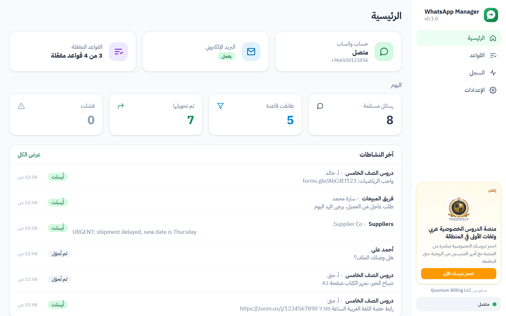
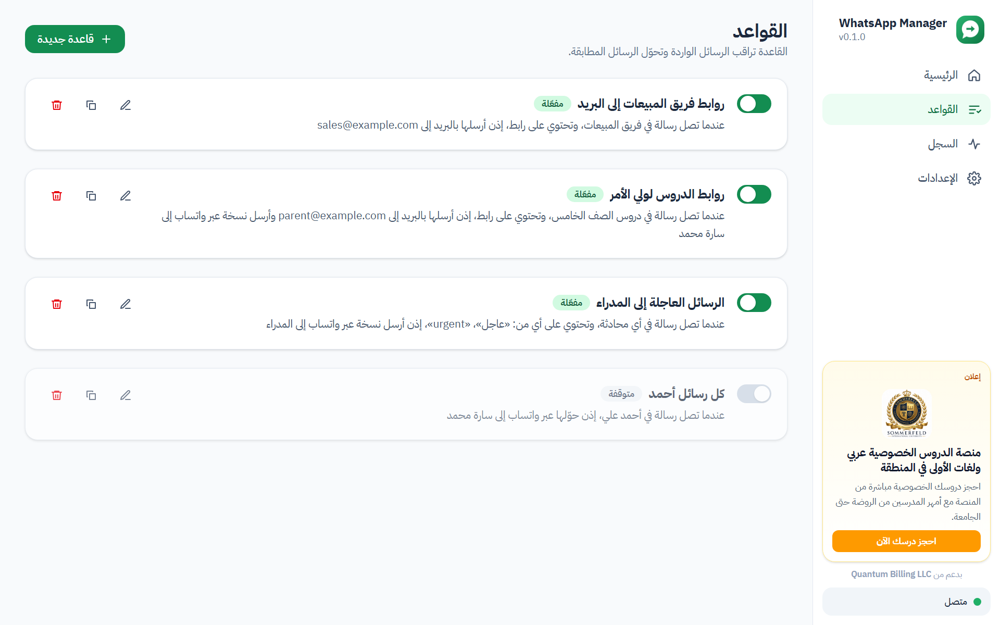
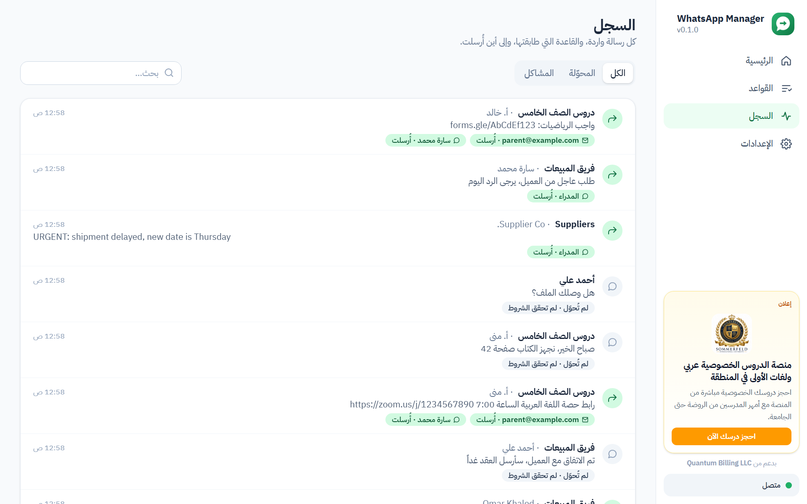
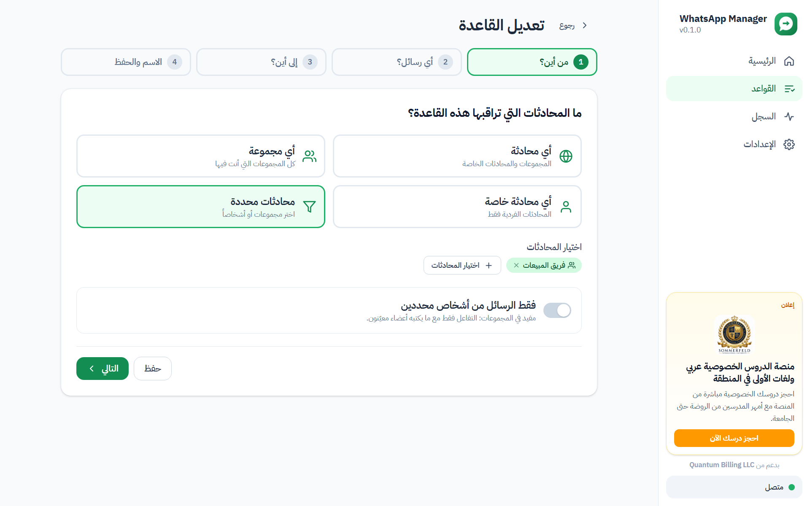
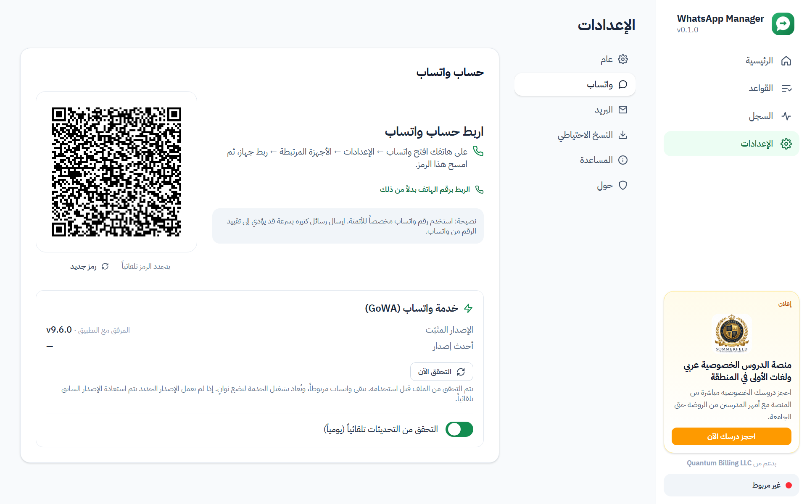
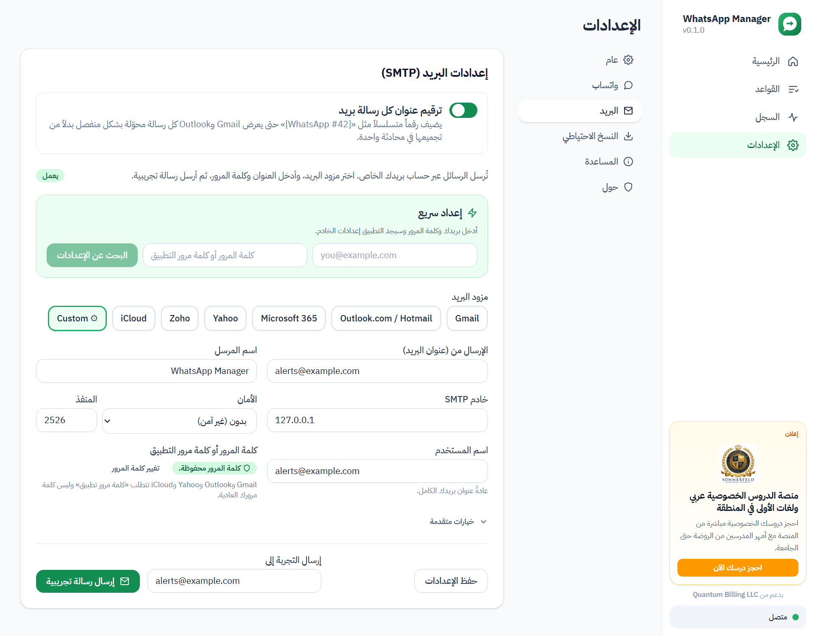
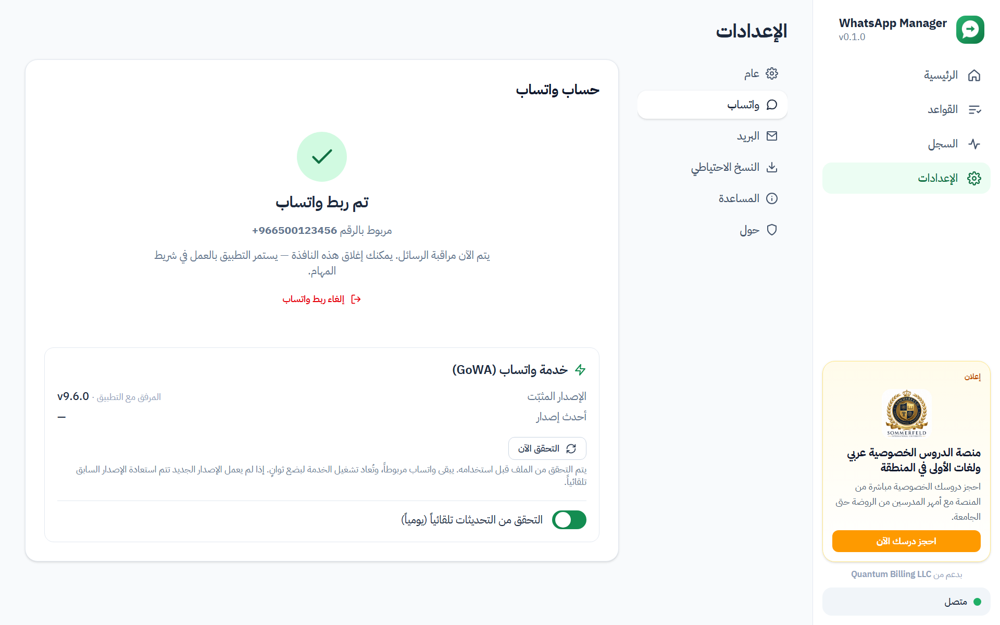

  
  <h1>WhatsApp Manager</h1>
  
<b>حوّل رسائل واتساب المهمة تلقائياً إلى الأشخاص المناسبين — عبر واتساب أو البريد الإلكتروني.</b>

  

    <a href="../../releases/latest"><b>⬇ التنزيل لويندوز</b></a> ·
    <a href="README.md">English</a> ·
    <a href="docs/user-guide.ar.md">دليل الاستخدام</a> ·
    <a href="docs/privacy.md">الخصوصية</a>
  

  

---

WhatsApp Manager تطبيق مجاني ومفتوح المصدر لنظام ويندوز، مصمم **لغير المختصين**. اربط واتساب بمسح رمز QR،
وأنشئ قواعد بسيطة، ويعمل التطبيق بهدوء في شريط المهام: يراقب مجموعاتك ومحادثاتك ويحوّل ما طلبته.

| عندما تصل رسالة… | و… | إذن |
|---|---|---|
| في مجموعة «فريق المبيعات» | فيها رابط | **أرسلها بالبريد** إلى `sales@company.com` |
| في مجموعة «دروس الصف الخامس» | فيها رابط زووم أو ميت أو أي رابط | **أرسلها بالبريد** لولي الأمر و**أرسل نسخة عبر واتساب** |
| في أي محادثة | فيها «عاجل» أو «urgent» | **أرسلها إلى مجموعة «المدراء»** |
| من *أحمد* | — | **حوّلها عبر واتساب** إلى سارة |

## لقطات الشاشة

| | |
|:---:|:---:|
|  **القواعد:** كل قاعدة بجملة واضحة مع زر تشغيل وإيقاف |  **السجل:** كل رسالة والقاعدة التي طابقتها وإلى أين أُرسلت |
|  **معالج القواعد:** من أين ← أي رسائل ← إلى أين ← حفظ |  **ربط واتساب** بمسح رمز QR أو برمز رقم الهاتف |
|  **البريد** عبر حسابك الخاص مع إعداد سريع وزر تجربة |  **خدمة واتساب** متصلة، مع تحديثات بنقرة واحدة |

## المزايا

**سهل للجميع**
- ملف تثبيت واحد، بدون صلاحيات مدير، وبدون أي إعدادات. الاتصال بواتساب مدمج.
- واجهة عربية افتراضياً، والإنجليزية متاحة، ويمكن التبديل في أي وقت.
- معالج للتشغيل الأول: اللغة ← ربط واتساب ← البريد (اختياري) ← اختيار قالب قاعدة.
- يبدأ مع ويندوز ويعمل في شريط المهام، وإغلاق النافذة لا يوقفه.

**قواعد مرنة**
- **من أين:** أي محادثة، أو أي مجموعة، أو أي محادثة خاصة، أو مجموعات وأشخاص محددون من واتساب، مع إمكانية
  الاقتصار على رسائل أشخاص معيّنين داخل المجموعات.
- **أي رسائل:** فيها رابط (لأي موقع، حتى لو كان ملتصقاً بالنص)، أو فيها كلمات، أو ليس فيها كلمات، أو نوع
  الرسالة (نص، صورة، مستند، صوت…). تتم مطابقة الهمزات والتشكيل واختلافات الإملاء تلقائياً.
- **إلى أين:** جهات اتصال أو أرقام أو مجموعات واتساب (تحويل الرسالة الأصلية أو إرسال نسخة مع «من … في …»)،
  و/أو عناوين بريد مع إرفاق الصور والملفات.
- مربع **جرّبها** لاختبار رسالة تجريبية قبل الحفظ.

**البريد**
- عبر **حسابك الخاص** (Gmail وOutlook وMicrosoft 365 وYahoo وZoho وiCloud أو أي خادم)، مع إعداد سريع ورسالة تجريبية.
- رقم متسلسل في عنوان كل رسالة (`[WhatsApp #42] …`) حتى لا يجمعها Gmail في محادثة واحدة، ويمكن إيقافه.

**موثوق**
- لا يرسل الرسالة نفسها مرتين لنفس الوجهة، ولا يدخل في حلقات تكرار.
- لا يغرقك برسائل قديمة بعد إطفاء الجهاز (فترة استدراك 12 ساعة افتراضياً).
- يعيد الاتصال تلقائياً، ويعيد تشغيل خدمة واتساب إذا توقفت. وتنتظر الرسائل أثناء انقطاع واتساب أو البريد ثم تُرسل.
- تُحذف الرسائل القديمة تلقائياً بعد 5 أيام، ويمكن تغيير المدة.
- **تحديثات خدمة واتساب:** يكتشف التطبيق الإصدارات الجديدة ويثبّتها بنقرة واحدة، مع التحقق من الملف والعودة
  للإصدار السابق تلقائياً إذا لم يعمل الجديد.

**خاص**
- كل شيء يبقى على جهازك. بدون حسابات أو سحابة أو تتبع، وكلمات المرور مشفرة بحماية ويندوز.

## التثبيت

1. نزّل **`WhatsAppManager-Setup-x.y.z.exe`** من [آخر إصدار](../../releases/latest). تتوفر أيضاً نسخة محمولة `.zip`.
2. شغّله. إذا ظهرت رسالة «حمى Windows جهازك» اضغط **مزيد من المعلومات ← تشغيل على أي حال**.
3. اتبع المعالج، واربط واتساب من هاتفك عبر **الإعدادات ← الأجهزة المرتبطة ← ربط جهاز**.

المتطلبات: ويندوز 10 (1809 أو أحدث) أو ويندوز 11، 64-بت.

> **نصيحة:** استخدم رقم واتساب مخصصاً للأتمتة. قد يقيّد واتساب الأرقام التي ترسل رسائل آلية كثيرة.

## أسئلة شائعة

<b>رسالة فيها رابط لم تُحوّل، لماذا؟</b>

افتح **السجل**. ستجد بجانب كل رسالة سبب تحويلها أو عدم تحويلها، مثل «ليست من محادثة مراقبة» أو «لم تحقق
الشروط» أو «وصلت قبل إنشاء القاعدة».

<b>البريد يقول «اسم المستخدم أو كلمة المرور غير صحيحة».</b>

Gmail وOutlook وYahoo وiCloud تتطلب **كلمة مرور تطبيق** وليس كلمة مرورك العادية. الرسائل محفوظة وستُرسل
تلقائياً بعد نجاح رسالة التجربة.

<b>هل يجب إبقاء النافذة مفتوحة؟</b>

لا. يعمل التطبيق في شريط المهام بجانب الساعة. للإيقاف اختر **خروج** من قائمة الأيقونة.

## بدعم من

**Quantum Billing LLC**: [quantum-billing.com](https://quantum-billing.com/) · ‎+1 361-405-5427‎ ·
[info@Quantum-Billing.com](mailto:info@Quantum-Billing.com)

## الترخيص

MIT. راجع [LICENSE](LICENSE) و[THIRD_PARTY_NOTICES.md](THIRD_PARTY_NOTICES.md).
التطبيق لا يتبع لواتساب أو ميتا ولا يحظى باعتمادهما.

