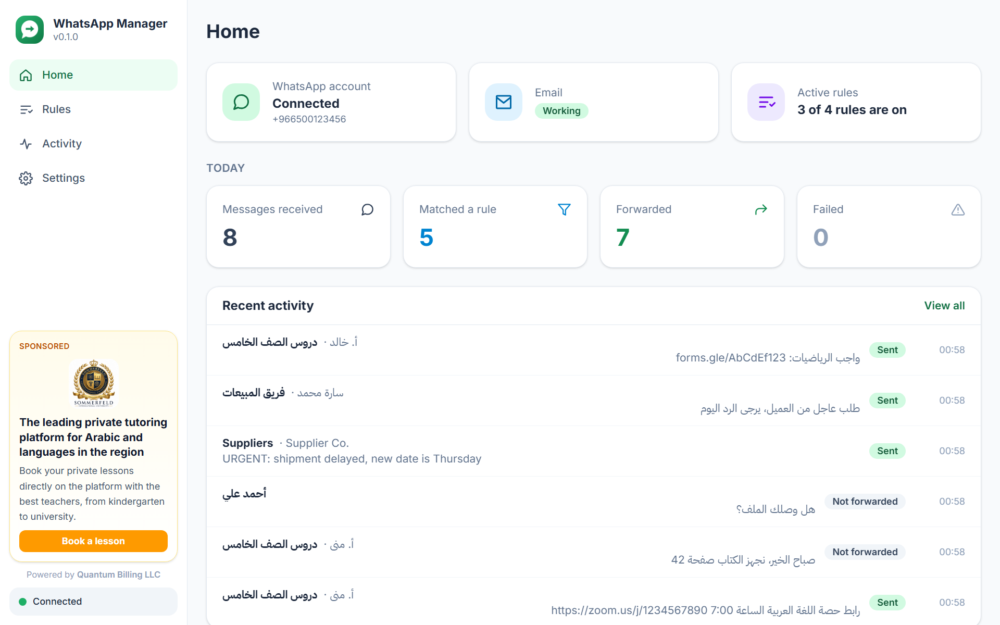
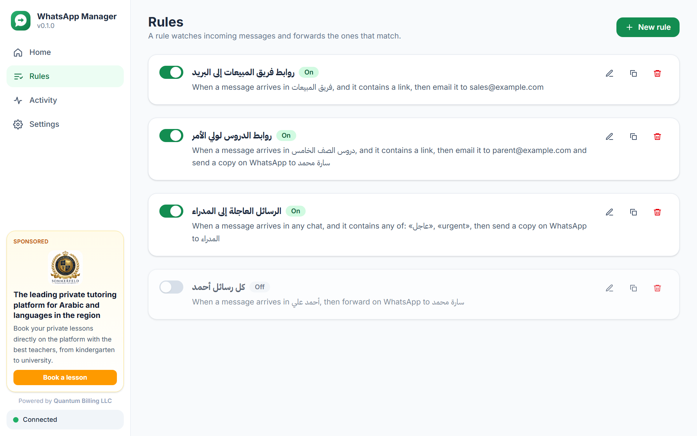
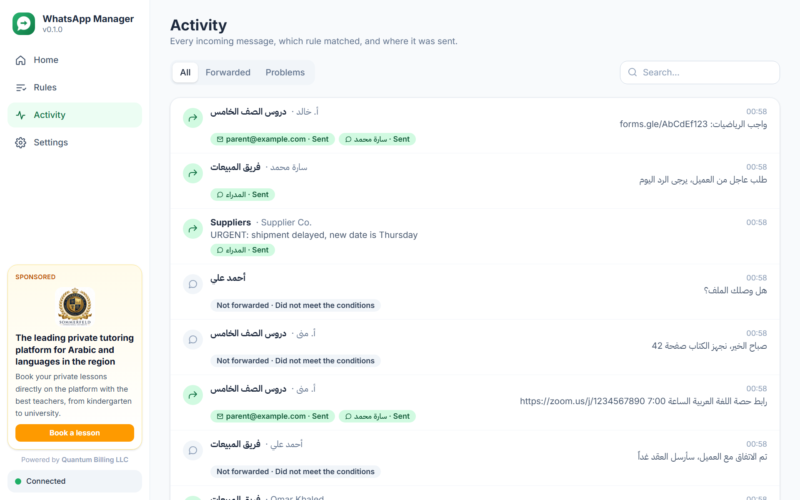
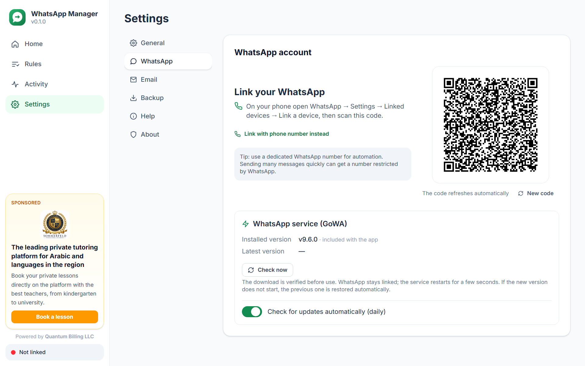

<div align="center">
  
  <h1>WhatsApp Manager</h1>
  <p><b>Automatically forward the WhatsApp messages that matter to the right people, by WhatsApp or by email.</b></p>
  <p>
    <a href="../../releases/latest"><b>⬇ Download for Windows</b></a> ·
    <a href="README.ar.md">العربية</a> ·
    <a href="docs/user-guide.en.md">User guide</a> ·
    <a href="docs/privacy.md">Privacy</a>
  </p>
  
</div>

---

WhatsApp Manager is a free, open-source Windows app for people who are **not technical**. You link your
WhatsApp by scanning a QR code, create simple rules, and the app runs quietly in the system tray, watching
your groups and chats and forwarding what you asked for.

| When a message… | …and | Then |
|---|---|---|
| arrives in the *"Sales Team"* group | contains a link | **email it** to `sales@company.com` |
| arrives in the *"Grade 5 Lessons"* group | contains a Zoom / Meet / any link | **email** the parent and **send a copy on WhatsApp** |
| arrives in any chat | contains *"urgent"* or *"عاجل"* | **send it to the "Managers" group** |
| comes from *Ahmed* | — | **forward it on WhatsApp** to Sara |

## Screenshots

| | |
|:---:|:---:|
| <br>**Rules**: each rule as a plain sentence, switch it on or off | <br>**Activity**: every message, the rule it matched, and where it went |
| <br>**Rule wizard**: where from → which messages → send to → save | <br>**Link WhatsApp** by scanning a QR code or with a phone-number code |
| <br>**Email** through your own account, with quick setup and a test button | <br>**Arabic by default** (right-to-left); English available |

## Features

**Easy for anyone**
- One installer, no administrator rights, nothing to configure. WhatsApp connectivity is built in.
- Arabic interface by default, English available. Switch any time from Settings or the tray icon.
- A first-run wizard: choose a language → link WhatsApp → (optional) set up email → pick a rule template.
- The app starts with Windows and lives in the system tray. Closing the window does not stop it.

**Flexible rules**
- **Where from:** any chat, any group, any private chat, or specific groups and people picked from your
  WhatsApp, plus optionally "only messages from these people" inside groups.
- **Which messages:** contains a link (any website, even glued to other text), contains words (any or
  all), does not contain words, or a message type (text, photo, document, voice…). Arabic spelling variants
  and diacritics are matched automatically (أ/ا/إ, ة/ه, ى/ي, tashkeel).
- **Send to:** WhatsApp contacts, phone numbers or groups (forward the original, or send a copy with
  "From … in …"), and/or email addresses, with photos and files attached.
- A **Try it** box checks a sample message against the rule before you save it.

**Email**
- Uses **your own** email account over SMTP: Gmail, Outlook, Microsoft 365, Yahoo, Zoho, iCloud, or any
  server. *Quick setup* finds the server settings from your address, and *Send test email* confirms they work.
- Each subject gets a running number (`[WhatsApp #42] …`) so Gmail doesn't group separate messages into
  one conversation. You can turn this off.

**Reliable**
- Never sends the same message twice to the same destination, even when several rules match or the
  WhatsApp service repeats a delivery.
- Never loops: it ignores your own messages and the messages it forwarded itself.
- After the PC was off, it doesn't flood you with old messages (12-hour catch-up window by default).
- Reconnects to WhatsApp by itself and restarts the WhatsApp service if it crashes. Messages wait while
  WhatsApp or email is offline and are sent when it is back.
- If the app is closed during a send, it marks that message "Unknown" instead of risking a duplicate.
- Old messages and history are cleaned up automatically after 5 days (adjustable).
- **WhatsApp service updates:** the app checks for new versions of its built-in WhatsApp service and
  installs them with one click. Each download is verified, and the app rolls back automatically if the
  new version does not start.

**Private**
- Everything stays on your PC. There are no accounts, no cloud and no telemetry.
- Passwords are encrypted with Windows' built-in protection (DPAPI).

## Install

1. Download **`WhatsAppManager-Setup-x.y.z.exe`** from the [latest release](../../releases/latest). A portable
   `.zip` is also available.
2. Run it. If Windows shows *"Windows protected your PC"*, click **More info → Run anyway** (this warning
   appears until the app is code-signed).
3. Follow the wizard: link WhatsApp on your phone under **Settings → Linked devices → Link a device**.

Requirements: Windows 10 (1809 or later) or Windows 11, 64-bit, with Microsoft Edge WebView2 (already
installed on current Windows).

> **Tip:** use a dedicated WhatsApp number for automation. WhatsApp may restrict numbers that send many
> automated messages. The app sends at most 20 WhatsApp messages per minute by default.

## FAQ

<details>
<summary><b>A message with a link was not forwarded. Why?</b></summary>

Open **Activity**. Each message shows why it was or was not forwarded, for example "Not from a watched
chat", "Did not meet the conditions" or "Arrived before the rule existed". Rules only apply to messages
that arrive after the rule is saved.
</details>

<details>
<summary><b>Email says "Wrong username or password".</b></summary>

Gmail, Outlook, Yahoo and iCloud need an **app password**, not your normal password. The help link next to
the password field explains how to create one. Messages are kept and sent automatically once a test email
succeeds.
</details>

<details>
<summary><b>Do I need to keep the window open?</b></summary>

No. The app keeps working in the system tray, next to the clock. Use **Quit** in the tray menu to stop it.
</details>

<details>
<summary><b>How do I get help?</b></summary>

Go to **Settings → Help → Download diagnostics** and attach the file to a
[GitHub issue](../../issues/new/choose). It contains logs and settings, but no passwords.
</details>

## How it works

```
WhatsAppManager.exe (Go)                          gowa\whatsapp.exe (GoWA)
 ├─ tray icon + WebView2 window (Vue UI)           ├─ WhatsApp multi-device client (whatsmeow)
 ├─ local API on 127.0.0.1 (token protected)  ◄─── ├─ signed webhook for each incoming message
 ├─ rule engine: inbox → outbox (SQLite)       ───► └─ REST API: forward / send (127.0.0.1, basic auth)
 └─ dispatcher: WhatsApp + SMTP, retries, rate limits
```

WhatsApp connectivity is provided by the unmodified release of
[GoWA (go-whatsapp-web-multidevice)](https://github.com/aldinokemal/go-whatsapp-web-multidevice), which runs
as a supervised child process. See [docs/PLAN.md](docs/PLAN.md) for the design and
[PROJECT_CONTEXT.md](PROJECT_CONTEXT.md) for the invariants.

## Build from source

Prerequisites: Go (version in `go.mod`), Node.js 22+, PowerShell, and
[Inno Setup 6](https://jrsoftware.org/isinfo.php) for the installer.

```powershell
./build.ps1                            # web UI + tests + exe + portable zip  -> dist/
./build.ps1 -Version 1.0.0 -Installer  # also the Setup.exe
```

To develop, run `go run ./cmd/whatsapp-manager --data-dir .\devdata`. It uses its own data folder, can run
alongside an installed copy, and never registers autostart. See [CONTRIBUTING.md](CONTRIBUTING.md) and
[docs/RELEASING.md](docs/RELEASING.md).

## Powered by

**Quantum Billing LLC**: [quantum-billing.com](https://quantum-billing.com/) · +1 361-405-5427 ·
[info@Quantum-Billing.com](mailto:info@Quantum-Billing.com)

## License

MIT. See [LICENSE](LICENSE) and [THIRD_PARTY_NOTICES.md](THIRD_PARTY_NOTICES.md).
WhatsApp Manager is not affiliated with, endorsed by, or connected to WhatsApp or Meta.
